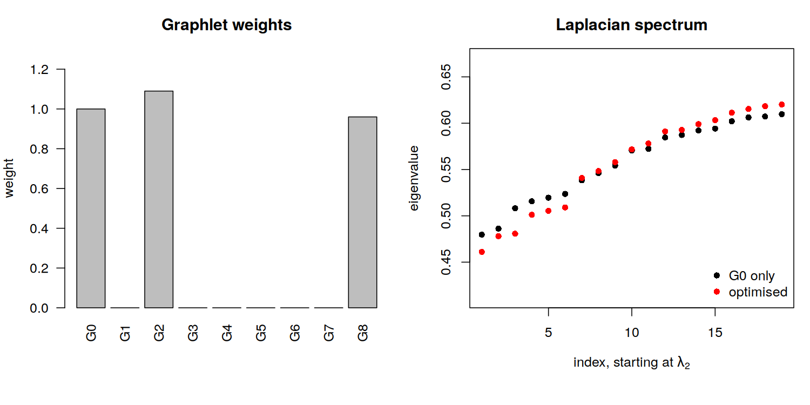

# Graphlet-Weighted Spectral Clustering

A method for community detection in graphs using graphlet-based adjacency matrices combined with spectral clustering, where the graphlet weights are optimised with Hooke–Jeeves pattern search.

## Overview
The adjacency matrix (G0) and the graphlet adjacency matrices (G1–G8) of an LFR network are computed using [GRADCO], called from R via `reticulate`. Spectral clustering is first applied to G0 alone as a baseline.

Each graphlet matrix G1–G8 is then normalised by its maximum, and Hooke–Jeeves pattern search finds the weights of the linear combination

```
AOPT = G0 + w1·G1 + w2·G2 + ... + w8·G8
```

that maximise the energy function `F = S + T - P`. Spectral clustering is repeated on `AOPT`, and both results are evaluated against the ground-truth communities using NMI.

## Method

### Spectral clustering
Applied in the same way to G0 (baseline) and to `AOPT`:

1. Symmetric normalised Laplacian: `L = I - D^(-1/2) A D^(-1/2)`
2. The 20 smallest eigenvalues and eigenvectors of `L` (`RSpectra::eigs_sym`)
3. Number of clusters `k` = index of the largest eigengap; the first gap (λ2 − λ1) is ignored, so `k ≥ 2`
4. The first `k` eigenvectors are row-normalised and clustered with k-means (`nstart = 10`, `iter.max = 500`)

### Energy function
For weights `w = (1, w1, ..., w8)`, `AOPT` is built, normalised to a maximum of 1, and its Laplacian eigenvalues λ1…λ20 are computed. With `G` the index of the largest eigengap and `gap` its size:

| Term | Formula | Role |
|------|---------|------|
| S | `log(gap · G / mean(λ1..λG) + 1)` | Spectral separation: a large gap after small eigenvalues |
| T | `log(mean(λ⁰1..λ⁰G) / mean(λ1..λG))` | Vertical shift: eigenvalues lowered relative to the G0 baseline λ⁰ |
| P | `α · Σw`, with `α = 1 / (1 + exp(-5(Σw - 4)))` | Sparsity penalty: switches on once the total weight exceeds 4 |

`S` and `T` are log-transformed, because very small eigenvalues would otherwise make the ratios dominate `P`.

### Hooke–Jeeves pattern search
The weights are optimised with the Hooke–Jeeves method, a derivative-free direct search, using `hjn()` from the `optimx` package. Each iteration has two steps:

- **Exploratory move:** each weight is changed by ±step in turn, and a change is kept only if it improves the objective.
- **Pattern move:** if the exploratory move improved the objective, the search jumps further in the same direction, then explores again from the new point.

When no move improves the objective, the step size is reduced. The search stops when the step falls below the tolerance or the evaluation budget is used up. Since `hjn()` minimises, the energy function returns `-F`.

Settings (`testHJN.r`):

| Parameter | Value |
|-----------|-------|
| Initial weights | 0.1 for w1–w8 |
| Bounds | 0 ≤ wi ≤ 3 |
| Max function evaluations | 500 |
| Tolerance (`eps`) | 1e-3 |
| G0 weight | fixed at 1 |

## Project Structure
```
LFR_Lap.r                    # Main script with the full pipeline
myLAPnorm.r                  # LAPnorm(): normalised Laplacian
EnergyFUNeigenLap.r          # energy_function: F = S + T - P
optHJN.r                     # Hooke–Jeeves optimisation of the weights (hjn)
graph_1668509426.txt         # LFR network (edge list, 0-indexed)
membership_1668509426.txt    # Ground-truth communities
lfr.png                      # Output: weights and eigenvalue plots
```

## Data 
The LFR network `graph_1668509426.txt` and its ground-truth communities `membership_1668509426.txt` are taken from the collection of LFR benchmark graphs by Toth (2021), created for the evaluation of Synwalk (Toth et al., 2022).

## Requirements
R packages:

```r
install.packages(c("igraph", "optimx", "reticulate", "RSpectra"))
```

Python packages: `gradco`, `numpy`.

Set the Python path in the script to match your environment:

```r
use_python("/usr/bin/python3")
```

## Usage
1. Place the network and membership files in the working directory.
2. Run `LFR_Lap.r`.
3. Results are printed to the console, and the plots are saved to `lfr.png`.

## Results
LFR network with 300 nodes and 9 ground-truth communities:

| | k | NMI | λ2 |
|---|---|---|---|
| G0 (baseline) | 3 | 0.239 | 0.480 |
| AOPT (optimised) | 7 | 0.591 | 0.461 |

Optimised weights: G2 = 1.090, G8 = 0.960, all others 0 (G0 fixed at 1). λ2 ratio (AOPT / G0) = 0.961.



- **Left:** optimised weights of G0–G8
- **Right:** eigenvalues λ2–λ20 of the normalised Laplacian, for G0 (black) and AOPT (red)


## Metrics
| Metric | Description |
|--------|-------------|
| k | Number of clusters, from the largest eigengap |
| NMI | Normalized Mutual Information with the ground truth, for G0 and AOPT |
| λ2 | Second smallest Laplacian eigenvalue for G0 and AOPT, and their ratio |


## References
- Toth, C. (2021). *A collection of LFR benchmark graphs* (Version v1) [Data set]. Zenodo. https://doi.org/10.5281/zenodo.4450167
- Toth, C., Helic, D., & Geiger, B. C. (2022). Synwalk: community detection via random walk modelling. *Data Mining and Knowledge Discovery*, 36(2), 739–780. https://doi.org/10.1007/s10618-021-00809-w
- Windels, S. F. L. (2024). *GRADCO: GRaphlet-orbit ADjacency COunter* (Version 0.1.8) [Python package]. https://pypi.org/project/gradco/


## Citation
A paper describing this method is in preparation. Until it is published, if you use this code, please cite the repository:

```
Rakić, M., & Pražnikar, J. Graphlet-Weighted Spectral Clustering [Computer software]. GitHub, 2026. https://github.com/marijarakic/graphlet-weighted-spectral-clustering
```

BibTeX:

```bibtex
@software{graphlet_weighted_spectral_clustering,
  author = {Raki{\'c}, Marija and Pra{\v{z}}nikar, Jure},
  title  = {Graphlet-Weighted Spectral Clustering},
  year   = {2026},
  url    = {https://github.com/marijarakic/graphlet-weighted-spectral-clustering}
}
```
[GRADCO]: https://pypi.org/project/gradco/
